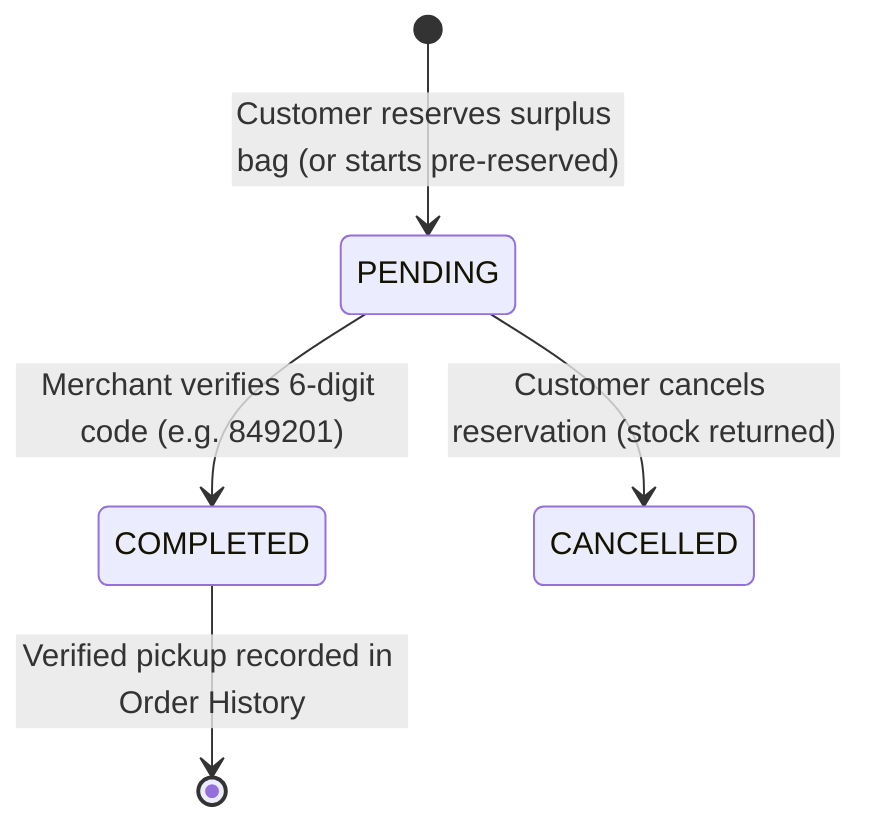

# Data Model: Foodlink Expanded Mock Marketplace

**Feature Branch**: `006-expand-mock-data`  
**Date**: 2026-10-30  
**Status**: Completed  

---

## 1. Entities & Schemas

### Entity 1: `ListingItem` (Customer Discover & Merchant Listing)
Represents a surplus food rescue item listed by a partner merchant.

```typescript
interface ListingItem {
  id: string;                    // Unique identifier (e.g. 'cad-sourdough-box', 'lst-101')
  storeId?: string;              // Merchant reference (e.g. 'st_cad', 'm-01')
  merchantId?: string;           // Harmonized ID for StoreContext ('m-01', 'm-02', etc.)
  storeName: string;             // Display name of store (e.g. 'CAD Bakery & Cafe')
  title: string;                 // Dish or surplus box title
  description: string;           // Detailed description of contents
  category: 'Pastry' | 'Asian' | 'Italian' | 'Healthy' | 'Food' | 'Dessert' | 'Drinks' | string;
  photoUrl: string;              // High-resolution Unsplash image URL
  image?: string;                // Normalized alias for photoUrl
  originalPrice: number;         // Original retail price in USD (e.g. 14.00)
  price: number;                 // Discounted rescue price in USD (e.g. 4.20)
  discountedPrice?: number;      // StoreContext alias for price
  discount: string;              // Formatted percentage string (e.g. '70% OFF')
  discountPercentage?: number;   // Numeric percentage (e.g. 70)
  bagsAvailable: number;         // Current inventory available for rescue
  remaining: number;             // Alias for bagsAvailable
  bagsSold?: number;             // Historical bags rescued count
  status: 'ACTIVE' | 'PAUSED' | 'SOLD_OUT';
  pickupDate?: string;           // e.g. 'Today'
  pickupStart?: string;          // e.g. '18:30' or '6:30 PM'
  pickupEnd?: string;            // e.g. '20:00' or '8:00 PM'
  pickupWindow?: string;         // e.g. '18:30 - 20:30'
  address?: string;              // Store physical address
  street?: string;               // District/Street shorthand
  rating?: number | string;      // e.g. 4.9
  distance?: string;             // Distance string e.g. '0.4 km'
  dietaryTags?: string[];        // Tags e.g. ['vegetarian', 'artisan', 'bakery']
}
```

### Entity 2: `StoreMapPin` (Google Maps Explore Network)
Represents a partner merchant pin plotted on the Google Maps roadmap canvas.

```typescript
interface StoreMapPin {
  id: string;                    // Unique pin ID (e.g. 'cad-bakery-1', 'brown-coffee-tk')
  storeName: string;             // Merchant name
  category: 'Bakery' | 'Meals' | 'Groceries' | 'Asian' | 'Healthy' | 'Italian' | 'Drinks';
  position: {
    lat: number;                 // Actual Phnom Penh latitude (11.5300 - 11.5800)
    lng: number;                 // Actual Phnom Penh longitude (104.9000 - 104.9400)
  };
  address: string;               // Full address in Phnom Penh
  street: string;                // District/Street shorthand (e.g. 'St. 310, BKK1')
  rating: number;                // e.g. 4.9
  ratingCount: number;           // e.g. 142
  distanceKm: number;            // Distance from simulated customer location (e.g. 0.4)
  formattedDistance: string;     // e.g. '0.4 km away'
  pickupWindow: string;          // e.g. '18:30 - 20:30'
  originalPrice: number;         // e.g. 8.50
  discountedPrice: number;       // e.g. 3.50
  discountPercentage: number;    // e.g. 59
  bagsAvailable: number;         // e.g. 3
  title: string;                 // Surplus bag headline
  description: string;           // Detailed description
  imageUrl: string;              // Unsplash photo URL
  logoIcon: string;              // Lucide icon hint ('croissant', 'salad', 'utensils', 'coffee', 'pizza')
  badgeText: string;             // e.g. '59% OFF'
  isPartner: boolean;            // true
}
```

### Entity 3: `MerchantOrder` (Kitchen Queue & Verification)
Represents an incoming customer order in the Merchant Portal.

```typescript
interface MerchantOrder {
  id: string;                    // Unique order ID (e.g. 'ord-901', 'ord-849201')
  orderNumber: string;           // Display number (e.g. '#FS-849201')
  pickupCode: string;            // 6-digit verification code (e.g. '849201')
  digits?: string[];             // ['8','4','9','2','0','1']
  listingId: string;             // Reference to ListingItem
  listingTitle: string;          // Dish title
  merchantId: string;            // Merchant store ID ('m-01' / 'st_cad')
  merchantName: string;          // Store name
  customerName: string;          // Customer display name (e.g. 'Dara Sok')
  avatarUrl?: string;            // Avatar image URL
  quantity: number;              // Total bags in order
  totalPrice: number;            // Total price in USD (e.g. 4.99)
  status: 'RESERVED' | 'PENDING' | 'COMPLETED';
  pickupWindow: string;          // Pickup window (e.g. '18:30 - 20:30')
  createdAt: string;             // ISO string or relative time
  verifiedAt?: string;           // Pickup completion timestamp (e.g. '18:42')
  items?: Array<{
    title: string;
    quantity: number;
    price: number;
    photoUrl?: string;
  }>;
}
```

### Entity 4: `CustomerActiveOrder` (Digital Pickup Pass)
Represents the active reservation displayed in the Customer "Reserved" tab.

```typescript
interface CustomerActiveOrder {
  orderNumber: string;           // '#FS-849201'
  pickupCode: string;            // '849201'
  digits: string[];              // ['8', '4', '9', '2', '0', '1']
  items: Array<{
    title: string;
    quantity: number;
    price: number;
    photoUrl: string;
  }>;
  storeName: string;             // 'CAD Bakery & Cafe'
  storeAddress: string;          // 'No. 42, Street 310, BKK1, Phnom Penh'
  pickupWindow: string;          // '18:30 - 20:30 (Today)'
  totalPrice: string | number;   // '4.99'
  customerName: string;          // 'Dara Sok'
  avatarUrl?: string;            // Customer avatar
  status: 'PENDING' | 'COMPLETED';
  verifiedAt?: string;           // Timestamp when verified by merchant (e.g. '18:42')
  co2SavedKg?: number;           // Environmental impact (e.g. 0.8)
  createdAt: string;             // Timestamp
}
```

### Entity 5: `NotificationItem` (Urgency & Restock Feed)
Represents surplus drop and order status alerts.

```typescript
interface NotificationItem {
  id: string;                    // e.g. 'notif-01'
  type: 'NEW_LISTING' | 'URGENT' | 'ORDER_READY' | 'RESTOCK';
  title: string;                 // Alert headline
  message: string;               // Alert summary text
  time?: string;                 // Formatted relative time (e.g. '10 mins ago')
  createdAt?: string;            // ISO timestamp
  isRead: boolean;               // Read flag
  listingId?: string;            // Optional reference
}
```

---

## 2. Validation Rules & Invariants

1. **Price Integrity**:
   - `originalPrice > price > 0`
   - `discountPercentage = Math.round(((originalPrice - price) / originalPrice) * 100)`
2. **Category Harmonization**:
   - Every listing must belong to one of: `Pastry`, `Asian`, `Italian`, `Healthy`, `Food`, `Dessert`, `Drinks`.
   - Each category MUST have >= 2 items to ensure filters are never empty.
3. **Phnom Penh Geographic Bounds**:
   - `11.5200 <= lat <= 11.5900`
   - `104.8800 <= lng <= 104.9500`
   - All street addresses must reference real Phnom Penh streets and Khan/Sangkat (BKK1, Daun Penh, Tuol Kouk, Tuol Tompoung, Tonle Bassac).
4. **Active Order Verification Code Alignment**:
   - Customer pickup pass code `849201` MUST match merchant pending order `#FS-849201` with `pickupCode: '849201'`.
   - Verification of `849201` in the merchant portal transitions status to `COMPLETED` and marks it completed in history.

---

## 3. State Transitions



